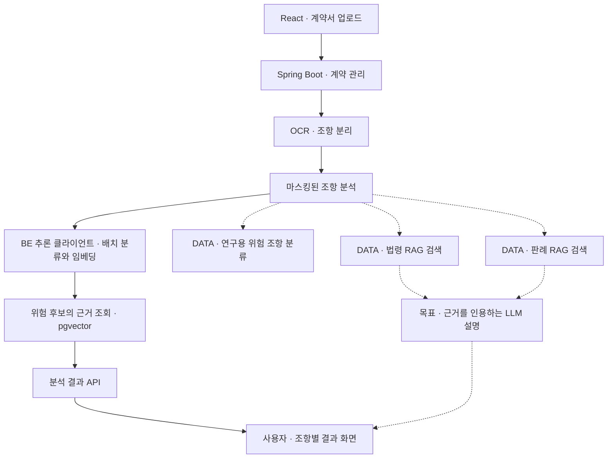

# ContractCheck · 데이터와 AI

**2026학년도 2학기 명지대학교 생성형 인공지능 7조 팀프로젝트**

ContractCheck는 주택임대차계약서를 조항별로 읽고, 주의해서 살펴볼 문구와 관련 법령·판례를 함께 보여주는 것을 목표로 합니다. 이 저장소에는 세 가지 질문을 다룬 코드와 실험 결과가 있습니다. **어떤 문구에 주목할 것인가**, **어떤 조문을 읽어야 하는가**, **어떤 판례를 참고할 수 있는가**입니다.

[Organization](https://github.com/ContractCheck-MJU) · [DATA — 모델과 검색](https://github.com/ContractCheck-MJU/DATA) · [BE — 계약 분석 API](https://github.com/ContractCheck-MJU/BE) · [FE — 사용자 화면](https://github.com/ContractCheck-MJU/FE)

[실험 한눈에 보기](#실험-한눈에-보기) · [서비스 구조](#서비스-구조) · [담당자와 저장소](#담당자와-저장소) · [분류와 검색 실험](#분류와-검색-실험) · [API 실행](#api-실행) · [한계와 다음 단계](#한계와-다음-단계)

## 실험 한눈에 보기

| 과제 | 데이터 | 모델과 평가 단위 | 주요 결과 |
|---|---|---|---|
| 시정 전후 요약문 분류 | 공정위 시정 사례 73쌍에서 얻은 요약문 143건 | TF-IDF + 로지스틱 회귀와 KLUE-RoBERTa를 같은 출처 그룹 5-fold로 비교 | 전체 검증 예측 Macro-F1 **0.8670 → 0.8741** |
| 법령 근거 검색 | 국가법령정보센터 조문 원문 95건, 청크 165개 | BGE-M3로 내부 질문 24개의 기대 조문 검색 | 중심화와 주성분 2개 제거 후 Hit@3 **70.8% → 83.3%** |
| 판례 근거 검색 | 국가법령정보센터 판례 16건, 청크 62개 | BGE-M3로 기존 질문 20개와 추가 질문 15개의 기대 판례 검색 | 중심화 후 기존 질문 Hit@3 **95% → 100%**, 추가 질문 Hit@1 **93.3% → 100%** |

Macro-F1은 두 약라벨의 F1을 평균합니다. Hit@K는 기대 근거가 상위 K개에 포함된 질문의 비율이고, MRR@K는 첫 기대 근거 순위의 역수를 평균한 값입니다(상위 K개에 없으면 0). 분류와 검색은 서로 다른 과제를 평가하며, 법적 판단의 정확도는 별도 검증이 필요합니다.

## 서비스 구조

실선은 저장소 코드에 있는 호출 또는 처리 흐름입니다. 점선은 DATA 모듈을 서비스에 연결하거나 근거 기반 설명을 제공하기 위해 남은 경로입니다. 실선도 배포 환경의 종단 간 테스트 통과를 뜻하지는 않습니다.

- **화면과 계약 처리.** FE는 React·TypeScript·Vite로 업로드, 분석 결과, 설명과 인용 화면을 구현했습니다. 기본값은 모의 API이며 `VITE_USE_MOCK=false`일 때 HTTP를 사용합니다. BE는 Java 21·Spring Boot 기반으로 OCR, 조항 분리, 외부 추론 전 개인정보 마스킹을 구현했습니다. 로컬 OCR 구현은 Apple Vision이며 운영용 Upstage 연동은 후속 작업입니다. [FE API 선택 코드](https://github.com/ContractCheck-MJU/FE/blob/main/src/api/config.ts) · [BE 계약 처리 코드](https://github.com/ContractCheck-MJU/BE/blob/main/src/main/java/ac/mju/contractcheck/service/ContractProcessor.java)
- **분류와 근거 검색.** BE의 HTTP 클라이언트는 배치 `/classify`와 `/embed`를 요청하고, 위험 후보의 근거는 Spring AI와 PostgreSQL/pgvector로 조회합니다. 아래 DATA FastAPI 3개는 독립 실행할 수 있습니다. 특히 DATA 분류 API는 단건 약라벨을 반환하므로 BE가 기대하는 `isRisky`, `riskType`, `probs`를 대신할 수 없습니다. DATA 검색 API의 후처리 성능이 BE의 DB 검색에도 재현되는지는 별도 검증 대상입니다. [BE 추론 규격](https://github.com/ContractCheck-MJU/BE/blob/main/src/main/java/ac/mju/contractcheck/client/InferenceMessages.java) · [BE 분석 흐름](https://github.com/ContractCheck-MJU/BE/blob/main/src/main/java/ac/mju/contractcheck/service/ClauseRiskService.java)
- **근거 기반 설명.** FE에는 설명·인용 표시 화면이 있습니다. BE의 설명 서비스는 현재 빈 설명을 저장하며, 실제 LLM 호출과 인용 저장은 TODO입니다. [BE 설명 서비스](https://github.com/ContractCheck-MJU/BE/blob/main/src/main/java/ac/mju/contractcheck/service/ExplanationService.java)

## 담당자와 저장소

| 담당자 | 담당 업무 | 주요 코드와 산출물 |
|---|---|---|
| 최영현 | 위험 조항 분류 모델 개발 | [risk-classification](risk-classification/README.md) · `ml/` 학습·승인 검증, `experiments/legacy_roberta/` 그룹 비교 실험, `api/` 추론, `spring-client/` Java 호출 예제 |
| 서제현 | 법령 임베딩 및 RAG 검색 | [law-embedding](law-embedding/README.md) · `data/` 조문·청크·벡터, `retrieval_fix/` 보정 파라미터, `evaluation/` 질문별 평가, `api/` 검색 |
| 이다혜 | 판례 임베딩 및 RAG 검색 | [precedent-search](precedent-search/README.md) · `data/processed/` 판례 메타데이터·NPZ 벡터·평가 결과, `data/evaluation/` 추가 질문, `scripts/` 검색 API와 보정 비교 |

## 분류와 검색 실험

### 위험 조항 분류 · 전통 모델과 한국어 Transformer 비교

시정 **후** 요약문 70건에 약라벨 0, 시정 **전** 요약문 73건에 약라벨 1을 부여했습니다. 같은 출처의 유사한 문장이 학습과 검증에 나뉘지 않도록 13개 출처 문서 ID로 그룹을 묶었습니다. 두 모델에 같은 5개 분할을 적용하고 각 문장이 검증 표본일 때의 예측을 한 번씩 모았습니다(Out-of-Fold, OOF).

| 모델 | 전체 143건 OOF Macro-F1 | 클래스 1 Precision | 클래스 1 Recall | 오분류 |
|---|---:|---:|---:|---:|
| TF-IDF + Logistic Regression | 0.8670 | 0.8649 | 0.8767 | 19건 |
| KLUE-RoBERTa-base 파인튜닝 | 0.8741 | 0.9104 | 0.8356 | 18건 |

한국어 사전학습 모델 `klue/roberta-base`를 fold별로 3 epoch 파인튜닝했습니다. Macro-F1 차이는 표의 표시값 기준 **+0.0071**(반올림 전 점수 기준 약 **+0.00704**)입니다. 시정 전 요약문을 놓친 수는 9건에서 12건으로 늘었습니다. 전달용 **fold 1**은 재현 가능한 연동을 위해 번호로 고정했으며, 이 모델의 자체 검증 24건 Macro-F1은 **0.7822**입니다. [공개 평가 결과](risk-classification/docs/LEGACY_EVALUATION.md)

실제 계약 도메인에서는 공식 판결문·결정문·공공기관 사례에서 계약 관련 **후보 27건**을 검토했습니다. AI 보조 1인 검수 의견은 정상 9건, 위험 7건, 보류 11건입니다. 우선 후보 10건에서 공식 직접 인용을 확인했고, 최종 학습 승인은 **0건**입니다. 이 후보를 이용한 재학습이나 실제 계약서 성능 평가는 수행하지 않았습니다.

### 법령 검색 · 관련 조문을 상위로 올리는 벡터 보정

조문별 출처 URL·버전과 청크 위치를 보존하고, `BAAI/bge-m3`로 1,024차원 벡터를 만들었습니다. 같은 조문의 여러 청크 중 가장 높은 코사인 유사도를 대표 점수로 사용합니다. 관련성이 낮은 조문이 상위에 나타나는 문제를 줄이기 위해 기존 문서 벡터의 평균을 빼고(Corpus Centering), 상위 주성분 2개를 제거한 뒤 재정규화했습니다. 질의에도 같은 변환을 적용하며 모델 파인튜닝이나 코퍼스 재임베딩은 필요하지 않았습니다.

| 법령 평가 · 질문 24개 | 보정 전 | 중심화 + 주성분 2개 제거 |
|---|---:|---:|
| Hit@1 | 62.5% | 70.8% |
| Hit@3 | 70.8% | 83.3% |
| MRR@3 | 0.667 | 0.764 |

계약 조항 형태와 사용자 질문 형태를 섞고, 쟁점을 직접 규정하는 조문을 기대 근거로 지정했습니다. 대체 근거 조문까지 인정하면 보정 후 Hit@1은 **79.2%**, Hit@3은 **91.7%**입니다. 같은 24개 질문으로 제거할 주성분 개수를 선택했으며 정답은 법률 전문가 검수 전입니다. [질문과 평가 설계](law-embedding/evaluation/retrieval_eval_report.md) · [보정 전후 결과](law-embedding/retrieval_fix/fix_validation.json)

### 판례 검색 · 같은 보정 방법을 다른 코퍼스에서 검증

판례 16건을 민사 관련 57개·형사 관련 5개 청크로 구성하고 판례번호, 사건명, 법원, 선고일, 원문 URL을 연결했습니다. BGE-M3의 1,024차원 벡터로 검색하고 판례별 최고 청크 유사도를 사용해 같은 사건이 상위 결과를 중복 점유하지 않게 했습니다.

법령 파트의 보정 실험을 이어받아 기존 벡터로 **중심화만 적용**, **중심화 + 주성분 1개 제거**, **중심화 + 2개 제거**를 비교했습니다. 기존 20문항에서 1개 제거는 중심화만 했을 때와 세 지표가 같았고, 2개 제거 시 MRR@3이 0.925에서 0.917로 낮아졌습니다. 판례 API에는 가장 단순한 **중심화 후 재정규화**를 적용했습니다. 두 모듈 모두 BGE-M3를 추가 학습하지 않았지만 코퍼스별로 선택한 보정 방식은 달랐습니다.

| 판례 평가 | Hit@1 전 → 후 | Hit@3 전 → 후 | MRR@3 전 → 후 |
|---|---:|---:|---:|
| 기존 질문 20개 | 85.0% → 85.0% | 95.0% → 100% | 0.900 → 0.925 |
| 추가 질문 15개 | 93.3% → 100% | 100% → 100% | 0.967 → 1.000 |

추가 질문은 보유 판례를 바탕으로 작성했습니다. 두 평가의 기대 판례는 팀이 지정한 임시 라벨이고, 15문항은 독립 외부 평가셋에 해당하지 않습니다. [기존 질문 보정 비교](precedent-search/data/processed/vector_correction_comparison.json) · [추가 질문 평가](precedent-search/data/processed/additional_evaluation_summary.json)

## API 실행

각 모듈의 디렉터리에서 해당 가이드에 따라 의존성을 설치하고 서버를 실행합니다. 포트는 로컬 개발 예시입니다.

| 모듈 | 포트 · POST 경로 | 요청 → 주요 응답 | 실행 문서 |
|---|---|---|---|
| 위험 분류 | 8000 · `/dev/v1/legacy/clauses/classify` | `clause_id`, `text` → 약라벨, 클래스 1 점수, 모델 버전, `research_only` | [설치와 체크포인트 배치](risk-classification/README.md) · [백엔드 API](risk-classification/docs/BACKEND_API.md) |
| 법령 검색 | 8002 · `/search/laws` | `query`, 선택적 `top_k` → 조문·청크 키, 본문, 출처, 유사도 | [법령 API 실행·요청 예시](law-embedding/api/README.md) |
| 판례 검색 | 8001 · `/search/precedents` | `query`, 선택적 `top_k`·`domain` → 판례번호, 청크 ID, 본문, 출처, 유사도 | [판례 API 실행·요청 예시](precedent-search/README.md) |

**연동 검증 범위.** 분류 API에는 별도로 전달받은 fold 1 가중치와 토크나이저가 필요합니다. 팀의 개발 환경에서 실제 HTTP 검사 16개, Java 모의 응답·오류 처리 검사 12개, Java에서 FastAPI로 보낸 요청 검사 3개가 통과했습니다. `research_only=true`를 보존하고 `weak_label`은 공정위 시정 전후 클래스로만 사용합니다. [Spring 클라이언트 예제](risk-classification/spring-client/README.md) · [연동 체크리스트](risk-classification/docs/INTEGRATION_CHECKLIST.md)

검색 파트는 팀에서 법령 실제 모델 구동과 판례 API 호출을 확인했습니다. 법령 API의 공개 자동 테스트 11개는 가짜 인코더로 입력 검증·중복 제거·오류 처리를 확인합니다. 검색 점수는 질의와 근거 청크 사이의 유사도이며 개별 조항에 해당 법령·판례가 적용되는지는 별도 판단이 필요합니다. [법령 API 테스트](law-embedding/tests/test_api.py) · [판례 API 구현](precedent-search/scripts/06_precedent_search_api.py)

## 한계와 다음 단계

1. **분류의 도메인 차이.** 시정 사례 요약문과 체결 계약의 문체·문맥이 다릅니다. 이용 권한과 문맥을 확인한 계약을 추가 검수하고, 같은 계약과 갱신계약을 한 그룹으로 묶어 독립 테스트셋을 확보할 계획입니다.
2. **검색 평가의 대표성.** 소규모 내부 질문과 잠정 정답에 의존합니다. 전문가 검수와 새로운 사용자 질문을 확보해 쟁점별 누락, 대체 근거, 법령 개정에 따른 변화를 점검해야 합니다.
3. **서비스 검증.** 실제 사용자 입력의 일반화 성능과 계약 업로드부터 최종 설명까지의 종단 간 정확도는 미평가 상태입니다. 배치 추론 규격을 조율하고, OCR 오류가 근거 검색에 미치는 영향과 인용 원문이 생성된 설명을 뒷받침하는지 단계별로 확인하는 것이 다음 과제입니다.
